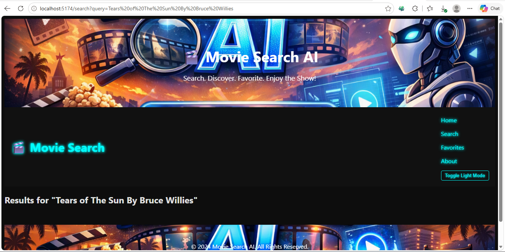

# 🎬 Movie Search AI Assistant


A React application built with AI assistance that allows users to search movies via the OMDb API, view details, and save favorites.

---

## 🚀 Live Demo & Repository
- **Movie Demo:**  
  
- **Live URL:** [Deployed App Link](https://movie-search-ai-assistant-55ok.vercel.app/)
- **Repository:** [GitHub Repo Link](https://github.com/leonardphokane/movie-search-ai-assistant)

---

## 📂 Project Structure
src/
├── components/        # Reusable UI components
│   ├── MovieCard.tsx
│   ├── NavBar.tsx
│   └── SearchBar.tsx
├── pages/             # Full-page views
│   ├── HomePage.tsx
│   ├── SearchResultsPage.tsx
│   ├── MovieDetails.tsx
│   ├── FavoritesPage.tsx
│   └── LoginPage.tsx
├── services/          # API logic
│   └── omdb.ts
├── context/           # Global state (AuthContext)
├── hooks/             # Custom hooks (useMovies)
├── App.tsx
├── index.tsx
└── global.css


---

## 📝 Prompts Log
Documented prompts used during development:

```text
Prompt 1: "Create a reusable SearchBar component for HomePage"
Prompt 2: "Add MovieDetails page to show plot, genre, director, actors, ratings"
Prompt 3: "Update index.tsx with routes for HomePage and MovieDetails"
Prompt 4: "Add responsive NavBar with dark/light theme toggle"
Prompt 5: "Fix JSX parse error in HomePage.tsx"
Prompt 6: "Wire SearchResultsPage to redirect with query params"
Prompt 7: "Implement FavoritesPage with localStorage persistence"
```
---

## 🤖 AI Assistance Reflection
AI accelerated development by:

- Generating boilerplate code for components, routing, and API integration.

- Explaining how to wire .env variables securely.

- Suggesting reusable component patterns (e.g., SearchBar, MovieCard).

- Helping debug syntax issues (e.g., JSX parse error with inline comments).

I validated each snippet, tested functionality, and made manual adjustments to ensure correctness and maintainability.

---

## 🔧 Manual Improvements & Refactoring
Examples of where I stepped in after AI’s output:

### Type Safety
// AI output
const [movies, setMovies] = useState<any[]>([]);

// My improvement
import { Movie } from '@services/omdb';
const [movies, setMovies] = useState<Movie[]>([]);

### JSX Parse Error

// AI output (invalid comment inside props)
<MovieCard id={movie.imdbID} {/* comment */} />

// My fix
{/* Pass imdbID for navigation */}
<MovieCard id={movie.imdbID} />

### Favorites Persistence

// AI output: no persistence
// My improvement: added localStorage support
localStorage.setItem("favorites", JSON.stringify(newFav));


---

## 🌟 Features
- 🔍 Search movies via OMDb API

- 📄 View detailed movie info

- ❤️ Save/remove favorites (persisted in localStorage)

- 🎨 Dark/light theme toggle

- 📌 Clean routing (/, /search, /movie/:id, /favorites, /about)

---

## 🛠️ Tech Stack

- React + TypeScript  
- Vite  
- React Router  
- OMDb API  
- LocalStorage for persistence  


### Visual Overview

| Vite | TypeScript | React |
|----------|------------|---------|
|  |  |  |
| *Vite* | *TypeScript* | *React* | 
 

---


## 📦 Assignment Deliverables
✅ Completed application (repo + live URL)

✅ Prompts log (prompts.md)

✅ AI assistance reflection (README section)

✅ Manual improvements/refactoring examples (manual-improvements.md)

---


